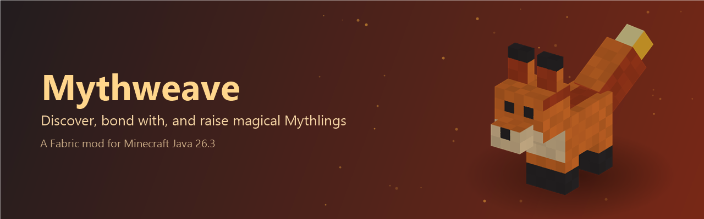
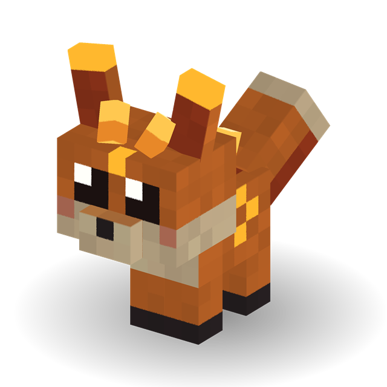
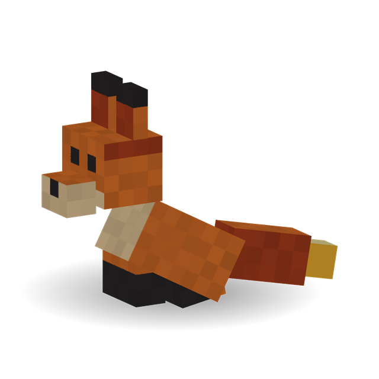
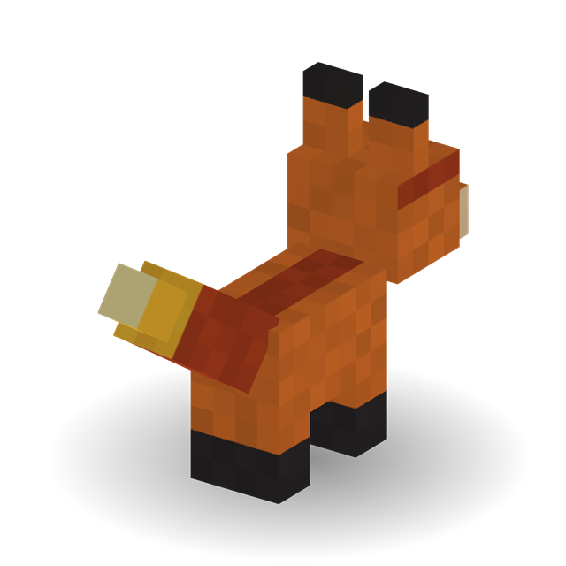
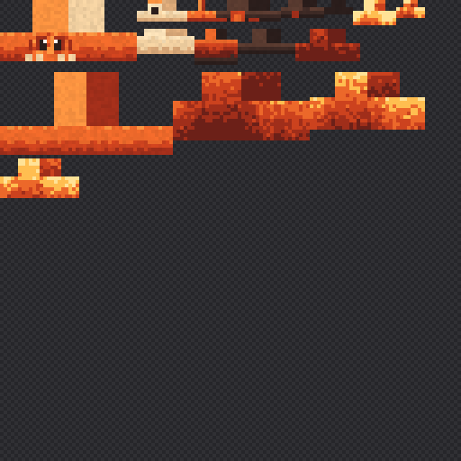

<p align="center">
  
</p>

<p align="center">
  <b>Minecraft Java 26.3</b> · <b>Fabric</b> · <b>Java 25</b> · <i>First Mythling complete: find, bond, command, Ember Spark</i>
</p>

---

**Mythweave** is a Fabric mod about discovering, bonding with, and raising original
magical creatures called **Mythlings**. It keeps the familiar survival experience and adds a
creature-collecting loop on top: find a Mythling, earn its trust, and it becomes a companion
that follows you, waits when told, and (in later versions) helps you explore with magical
abilities.

> Mythweave is a **single mod**, not a modpack. It needs only Fabric Loader and Fabric API.

All creatures, models, and textures are original. Mythweave does not use any Pokémon names,
designs, or assets.

## Contents

- [Meet Cindercub](#meet-cindercub)
- [How to play](#how-to-play)
- [Features and roadmap](#features-and-roadmap)
- [Installing (players)](#installing-players)
- [Building from source (developers)](#building-from-source-developers)
- [Testing checklist](#testing-checklist)
- [Project structure](#project-structure)
- [Technical notes](#technical-notes)
- [License and credits](#license-and-credits)

**Want to help build it?** Read [CONTRIBUTING.md](CONTRIBUTING.md): setup, where things go,
and step-by-step checklists for adding creatures, evolution forms, blocks and abilities.

## Meet Cindercub

<table>
  <tr>
    <td align="center"><br><sub>Wild: a fluffy fox tail</sub></td>
    <td align="center"><br><sub>Bonded and sitting</sub></td>
    <td align="center"><br><sub>Bonded: a tail of living fire</sub></td>
  </tr>
</table>

The first Mythling: a little ember spirit shaped like a fox kit. It has a big head with large
shining eyes, tall ember-tipped ears, two tiny amber crystal horns, crystal shards along its
spine, and glowing rune marks that breathe with a soft light. A wild one has a fluffy fox
tail; **once it bonds with you, its tail ignites into living fire** that ripples, flickers and
streams embers. It tilts its head and twitches its ears while it watches you. Curious,
playful, and a little mischievous.

| | |
|---|---|
| **Species** | Ember fox Mythling |
| **Element** | Fire / Ember |
| **Rarity** | Common |
| **Health** | 12 (6 hearts) |
| **Size** | 0.5 × 0.7 blocks (ears, horns and the tail flame stick out above) |
| **Temperament** | Passive. Wanders, watches nearby players, runs away when hurt. Never attacks. |
| **Bonds with** | Blaze Powder |
| **Habitat (planned)** | Savannas, badlands, warm caves |

<sub>The images above are generated from the mod's real model layout and texture by
<code>tools/previews/cindercub.ps1</code>. Lighting is approximate.</sub>

## How to play

> **Finding one:** natural spawning isn't in yet. For now, use the **Cindercub Spawn Egg**
> (Creative inventory → Spawn Eggs) or the command `/summon mythweave:cindercub`.

1. **Approach a wild Cindercub.** Right-click it with an empty hand and it'll hint at what it wants.
2. **Bond with it:** right-click it holding **Blaze Powder**. One powder is used, hearts appear,
   and you'll see *"Cindercub has bonded with you!"*. Bonding always succeeds.
3. **Walk away:** your Cindercub follows you. If you get more than 12 blocks ahead and it can't
   catch up, it teleports to your side.
4. **Tell it to wait:** right-click it with an empty hand. It sits and stays put.
   Right-click again and it gets up and follows you.
5. **Ember Spark:** place an **Ember Brazier** nearby, then right-click your Cindercub
   holding **Blaze Powder**. It flicks a spark at the closest unlit brazier it can see
   (within 8 blocks) and lights it. Then it needs **15 seconds** to recharge.

### Kindle: growing your bond

A bonded Cindercub earns **Kindle**, the bond energy that will let it evolve. It earns it by:
- spending time near you (+1 a minute),
- travelling with you (+3 per 100 blocks),
- discovering a new biome (+10, with a message),
- using Ember Spark (+5),
- seeing hostile mobs defeated nearby (+8),
- surviving hits from them (+2, at most once every 10 s).

Fighting pulls it toward **Ashenox**; exploring pulls it toward **Solflare**.

- **Check progress:** sneak and right-click your Cindercub with an empty hand to see, for
  example, *"Cindercub · Kindle 37/150 · leaning toward Solflare (exploration)"*.
- At **150 Kindle** its flame flares up and it's ready to evolve. The evolution itself
  arrives in the next update (see [docs/design/evolution.md](docs/design/evolution.md)).

### The Ember Brazier

An iron bowl of coals that only a Cindercub can light. Lit, it glows at full brightness
(light level 15) and crackles. It's safe to put anywhere: the flame is part of the block,
so it never spreads fire, burns nearby blocks, or hurts anyone who touches it.

- **Craft it:** iron nuggets around Blaze Powder and coal (or charcoal), on an iron ingot.

  | | | |
  |:-:|:-:|:-:|
  | Iron Nugget | Blaze Powder | Iron Nugget |
  | Iron Nugget | Coal | Iron Nugget |
  | | Iron Ingot | |

- **Put it out:** right-click a lit brazier with an empty hand.
- **Find it in Creative:** Functional Blocks tab. Mine it with a pickaxe (it drops itself).

### Interactions

| Who | Holding | What happens |
|---|---|---|
| Anyone (wild Cindercub) | Blaze Powder | Bonds. Uses 1 powder. |
| Anyone (wild Cindercub) | Empty hand | A hint about what it likes. |
| Owner | Blaze Powder | **Ember Spark:** lights the nearest visible unlit Ember Brazier within 8 blocks. 15 s cooldown. No powder used. |
| Owner | Empty hand (or an item with no other use on it) | Toggles sit / follow. |
| Owner, sneaking | Empty hand | Shows its Kindle (evolution progress) and which way it's leaning. |
| Owner | Lead, name tag, … | Works like on any vanilla animal. |
| Another player | Blaze Powder or empty hand | *"This Cindercub is already bonded to another player."* Nothing changes. |

### Good to know

- **The bond is saved.** Owner and sitting state survive saving, quitting, and reloading.
- **If you log out or change dimension**, your Cindercub sits and waits, then follows again when you're back.
- **If you die**, it stays bonded and follows you after you respawn.
- **Breeding isn't supported** (on purpose, for now).
- **It glows**: runes, eye shine, crystals and (once bonded) its fire tail stay lit in the
  dark, so you can always spot your Cindercub. In rain or water its embers turn to steam.

### Known limitations

- **No natural spawning yet.** Use the spawn egg or `/summon` (see above).
- **Sounds are borrowed.** Cindercub has its own sound events and subtitles ("Cindercub
  yips"), but for now they play vanilla fox sounds at a higher pitch. Original audio can be
  dropped in later by editing `assets/mythweave/sounds.json`, with no code changes.
- **Another player can put a lead on your Cindercub**, like a vanilla wolf. They still can't
  bond with it, command it, or use its ability.

## Features and roadmap

Mythweave is built in small, tested phases. Each one works in-game before the next starts.

- [x] **Phase 0: Project setup.** Fabric 26.3 template, builds and launches.
- [x] **Phase 1: Register Cindercub.** Entity type, attributes, spawn egg.
- [x] **Phase 2: Render Cindercub.** Original model, texture, walk/look/tail animation.
- [x] **Phase 3: Behavior.** Wander, look around, swim, flee when hurt.
- [x] **Phase 4: Bonding and companion.** Bond with Blaze Powder, follow owner, sit/stand.
- [x] **Phase 5: Save/load and multiplayer checks.** Dedicated server, two-player tests,
  one-command dev launcher.
- [x] **Phase 6: Signature ability.** *Ember Spark* lights an Ember Brazier block on
  command, with a cooldown. It can't set the world on fire.
- [x] **Phase 7: Polish.** Glowing ember tail tip, Cindercub sounds with subtitles, its own
  spawn egg, cleaner sitting pose.
- [ ] **Design pass: mythical and cute.** Chibi proportions, big eyes, crystal horns and spine
  shards, glowing rune marks, fox tail that ignites into a rippling fire tail when bonded,
  fire animations (flicker, breathing glow, embers), idle head tilt and ear twitches.
  *(Built; awaiting in-game test.)*
- [ ] **Evolution.** Bond XP ("Kindle") evolves Cindercub → Emberlynx → Ashenox or Solflare.
  See [docs/design/evolution.md](docs/design/evolution.md).
  - [ ] **E1: Kindle.** Earn, save and check Kindle and branch leaning; test command.
    *(Built; awaiting in-game test.)*
  - [ ] E2: evolution moment + Emberlynx · E3: Ashenox · E4: Solflare · E5: balance

**Later ideas** (after Cindercub is solid): more Mythlings, natural spawning in warm biomes,
the *Aether Shard* bonding item, branching evolutions (*Ashenox*, a combat-focused volcanic
fox, and *Solflare*, an exploration-focused one), magical shrines, and a creature journal.

## Installing (players)

> There are no published releases yet. Build the JAR yourself (see below).

1. Install **Java 25** (Minecraft 26.3 requires it).
2. Install **[Fabric Loader](https://fabricmc.net/use/) 0.20.1 or newer** for Minecraft **26.3**.
3. Put **[Fabric API](https://modrinth.com/mod/fabric-api)** for 26.3 in your `mods` folder.
4. Put `mythweave-1.0.0.jar` in your `mods` folder too.
5. Launch the *Fabric* profile.

The mod is required on both the client and the server when playing multiplayer.

## Building from source (developers)

**You need:** JDK 25 and Git. Gradle downloads itself through the wrapper. If you're going to
change code, start with [CONTRIBUTING.md](CONTRIBUTING.md).

```bash
git clone <this repository>
cd mythweave
```

### One-command launcher (Windows)

Double-click **`dev.cmd`** for a menu, or run it with a command:

```bash
.\dev.cmd client
```

| Command | What it opens |
|---|---|
| `.\dev.cmd client` | Minecraft with the mod, as **Player1** (singleplayer) |
| `.\dev.cmd multiplayer` | A dedicated server plus **Player1** and **Player2**, each in its own window. Both join the server automatically. |
| `.\dev.cmd server` | Only the dedicated server (folder `run-server/`) |
| `.\dev.cmd client2` | A second Minecraft, as **Player2** (folder `run-client2/`) |
| `.\dev.cmd build` | Builds the JAR |

It finds JDK 25 by itself. The first time you start the server, it asks you to accept the
[Minecraft EULA](https://aka.ms/MinecraftEULA), switches the server to offline mode (dev
clients have no Microsoft login), and makes Player1 and Player2 operators so `/summon` and
other commands work. Type `stop` in the server window to shut it down.

The usernames are fixed on purpose: offline players' UUIDs come from their name, and
Minecraft's default dev name is random, so with a random name each relaunch you'd be a
"different player" and your bonded Cindercubs would say they belong to someone else.

### Gradle directly

Build the mod JAR (output: `build/libs/mythweave-1.0.0.jar`):

```bash
./gradlew build
```

Launch a development client with the mod loaded (logs in `run/logs/latest.log`):

```bash
./gradlew runClient
```

On Windows PowerShell use `.\gradlew.bat` instead of `./gradlew`. The first build downloads
Minecraft and dependencies and takes a few minutes. After that, builds take seconds.

Other useful tasks:

| Task | What it does |
|---|---|
| `./gradlew runServer` | Starts a dedicated server with the mod (checks no client-only code leaks into the server). |
| `./gradlew runClient2` | A second client as Player2, for multiplayer tests. |
| `./gradlew runClient -PjoinServer=localhost` | The client joins that server as soon as it starts. |
| `./gradlew genSources` | Decompiles Minecraft so you can read vanilla code in your IDE. |

<details>
<summary><b>Troubleshooting</b></summary>

- **`java -version` still shows an older Java:** open a new terminal after installing JDK 25,
  or point `JAVA_HOME` at the JDK 25 folder.
- **Downloads from `fabricmc.net` hang or time out:** some networks have broken IPv6. Java and
  Gradle prefer IPv4 and are usually fine. Node-based tools such as the Fabric CLI may need
  `NODE_OPTIONS=--dns-result-order=ipv4first`.
- **Harmless log noise in the dev client:** Windows "Perflib"/OSHI warnings, and `401` or
  Realms errors (the dev client uses an offline test account).

</details>

## Testing checklist

A quick in-game test of everything that works so far. Use a Creative world with cheats on.

1. Spawn a few Cindercubs with the spawn egg. They should appear, wander, and look at you.
2. Hit one. It should run away for a few seconds. Push one into water: it swims out.
3. Right-click a wild one with an empty hand: you see the Blaze Powder hint.
4. Right-click with Blaze Powder: hearts, the "bonded" message, one powder used.
5. Walk 10+ blocks away: it follows. Sprint far: it teleports to you.
6. Right-click with an empty hand: it sits and stays. Again: it follows.
7. Sit it, save and quit, reload: still sitting, still yours. Repeat while it's standing.
8. *(Multiplayer, `.\dev.cmd multiplayer`)* Player2 can't bond with or command Player1's
   Cindercub. Player1 logs out and back in: it's still sitting and still answers to them.
   `stop` the server and start it again: owner and sitting state are unchanged.

9. Place an Ember Brazier within 8 blocks. Right-click your Cindercub with Blaze Powder:
   spark trail, the brazier lights, "lights the brazier!". Right away again: "recharging (N s)".
   After 15 s with no unlit brazier around: "can't see an unlit Ember Brazier".
10. Put the brazier behind a wall: the Cindercub won't light it. Put it out with an empty
    hand and relight it after the cooldown. Nothing around it ever catches fire.

11. At night (or `/time set midnight`), the runes, eyes, horns and tail flame glow and slowly
    pulse; the tail flame flickers and drops embers (more when running, steam in rain). Turn on subtitles (Options →
    Accessibility): you see "Cindercub yips"/"hurts". The spawn egg is an orange egg with
    dark spots and an ember fleck. A sitting Cindercub's hind legs don't flicker.

12. *(Kindle)* Sneak + right-click your bonded Cindercub with an empty hand: you see its
    Kindle status. Use Ember Spark and check again: +5, leaning Solflare. Walk into a new
    biome together: "+10 Kindle" message. Kill a zombie next to it: +8, leaning shifts.
    Save, quit, reload: the numbers are unchanged. A wild one earns nothing.
13. *(Test command, operators)* `/mythweave kindle add @e[type=mythweave:cindercub,distance=..5] 150`
    triggers the "ready to evolve" flare. `/mythweave kindle get @e[type=mythweave:cindercub,limit=1,sort=nearest]`
    prints the status. Add `combat` or `exploration` to the `add` command to push the leaning.

Run `./gradlew build` before committing; it must end in `BUILD SUCCESSFUL`.

## Project structure

Code is **layered by type**, the usual Minecraft-mod convention: one package per kind of
thing (entities, abilities, evolution, blocks, registries, events), with creatures nested by
name. What belongs where, and step-by-step checklists for adding creatures, forms, abilities
and blocks, are in [CONTRIBUTING.md](CONTRIBUTING.md).

```text
src/main/java/com/ashi/mythweave/           Common code (runs on client and server)
├── Mythweave.java                          Mod entry point: calls the registries, then events
├── registry/                               Every registration, one class per kind
│   ├── ModEntities.java                    Entity types and their attributes
│   ├── ModItems.java, ModBlocks.java       Items (spawn eggs, block items); blocks
│   ├── ModSounds.java                      Sound events (what they play: sounds.json)
│   └── ModCreativeTabs.java                Where items appear in the Creative inventory
├── entity/
│   ├── base/MythlingEntity.java            Base class: bonding, owner controls, sit, AI, Kindle
│   ├── base/Mythling.java                  Interface: kindle(), evolutionLine()
│   └── cindercub/CindercubEntity.java      Cindercub: stats, sounds, Ember Spark hook, embers
├── evolution/
│   ├── EvolutionRules.java                 Thresholds, Kindle sources, branch logic
│   ├── EvolutionLine.java                  One species' forms (stage 1 → 2 → two stage-3s)
│   ├── EvolutionLines.java                 Every species' line (Cindercub → Emberlynx → …)
│   ├── Kindle.java                         One Mythling's Kindle: earning, saving, status
│   └── KindleEvents.java                   Kindle from fights nearby (Fabric events)
├── ability/
│   ├── Ability.java                        Interface every ability implements
│   ├── AbilityCooldown.java                Per-creature cooldown: tick, save, load
│   └── EmberSparkAbility.java              Ember Spark: target search, effects
├── block/EmberBrazierBlock.java            Ember Brazier: lit state, shape, particles
├── command/MythweaveCommands.java          /mythweave kindle get|add (operators, for testing)
└── event/ModEvents.java                    Hooks listeners and commands into the game

src/client/java/com/ashi/mythweave/client/  Client-only code (never loaded on a server)
├── MythweaveClient.java                    Client entry point: calls the client registries
├── registry/
│   ├── ModModelLayers.java                 Model layer ids (+ registration)
│   └── ModRenderers.java                   Entity type → renderer
├── model/entity/CindercubModel.java        Cube layout, animation, fur/fire tail, sit pose
└── render/entity/
    ├── CindercubRenderer.java              Connects model + texture to the entity
    ├── state/CindercubRenderState.java     Per-frame data the model reads (sitting, tame)
    └── layer/PulsingGlowLayer.java         Any creature's glow map, full-bright and breathing

src/main/resources/
├── fabric.mod.json                         Mod metadata, entry points, dependencies
├── assets/mythweave/
│   ├── textures/entity/<creature>/         Per creature: texture + glow map
│   ├── textures/block/, textures/item/     Block and item textures
│   ├── blockstates/, models/, items/       Block and item models and appearances
│   ├── sounds.json                         What the sound events play
│   └── lang/en_us.json                     English names, messages, subtitles
└── data/                                   Recipes, loot tables, tags

tools/textures/, tools/previews/            Scripts that paint textures and render README images
docs/design/                                Specification and evolution design
docs/dev/                                   Setup notes
dev.cmd / dev.ps1                           One-command launcher (client, server, multiplayer)
```

### The texture

<p align="center">
  
</p>

The 64 × 32 texture, scaled 8× (the checkerboard is transparent). Each rectangle is one
body part unfolded flat: head, snout, ears, horns, spine shards, body, tail, tail flame, and
legs. The glowing pixels are also written to a separate glow map (`cindercub_glow.png`). Edit it in any
pixel editor or Blockbench, or change the colors in `tools/textures/cindercub.ps1` and
run:

```bash
powershell -ExecutionPolicy Bypass -File tools/textures/cindercub.ps1
```

## Technical notes

- **Versions** (from `gradle.properties`): Minecraft 26.3, Fabric Loader 0.20.1,
  Fabric API 0.165.0+26.3, Loom 1.19, Gradle 9.8.2, Java 25.
- **No mappings step.** Minecraft 26.x ships unobfuscated, so the code uses Mojang's own names
  (e.g. `net.minecraft.resources.Identifier`) and the plugin is `net.fabricmc.fabric-loom`.
- **Client/server split.** `splitEnvironmentSourceSets()` keeps rendering code in `src/client`,
  so a dedicated server never loads it.
- **Bonding reuses vanilla.** Every Mythling extends `MythlingEntity`, a `TamableAnimal`, which stores the owner
  as a UUID, saves `Owner` and `Sitting` with the entity, and syncs both to clients. No custom
  save code or network packets.
- **Server-authoritative.** Every bond, sit toggle, and message is decided on the server.
  The client only predicts the arm swing.
- **26.3 API notes:** entity types and items must be built with their registry key; spawn eggs
  use `Item.Properties#spawnEgg`; renderers fill a *render state* each frame that the model
  animates from; Fabric's `EntityRendererRegistry` is deprecated in favor of vanilla's
  `EntityRenderers.register`; action-bar messages use `Player#sendOverlayMessage`.

The full design (pillars, phase plan, and acceptance criteria) is in
[docs/design/specification.md](docs/design/specification.md).

## License and credits

The project currently carries the Fabric example template's **CC0 1.0** license
([LICENSE](LICENSE)). A final license for Mythweave hasn't been chosen yet.

- Created by **ashi**.
- Built on the [Fabric example mod](https://github.com/FabricMC/fabric-example-mod) template.
- Cindercub's design, model, and texture are original to this project.

Mythweave is not an official Minecraft product and is not approved by or associated with Mojang or Microsoft.
